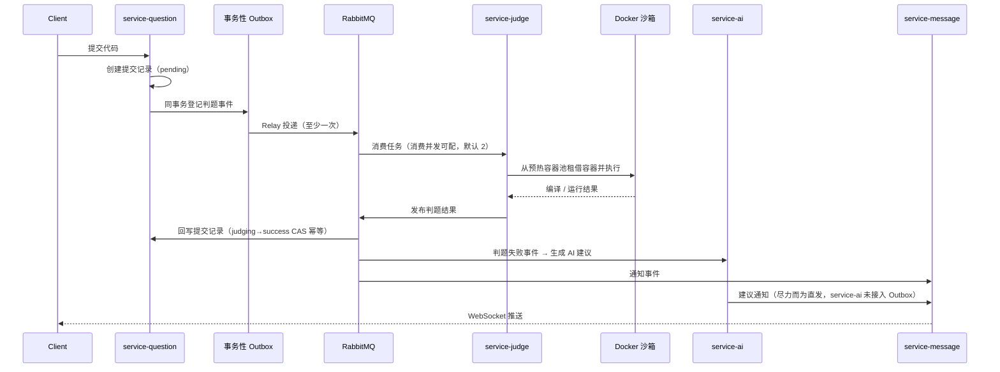

# CodeWise 技术设计

## 1. 设计目标

CodeWise 面向在线刷题场景，核心目标是把高延迟、高风险的代码执行过程与普通业务请求隔离，同时保证题目、提交、复习、社区和通知能力能够独立演进。

当前架构采用 Spring Cloud 微服务体系。Nacos 负责服务发现和外部配置，Gateway 提供统一入口，Feign 承担同步服务调用，RabbitMQ 承担判题和通知等异步链路，Redis 用于缓存、状态、计数和分布式协调。此外还有一个独立的 Python 服务 `codewise-agent`（FastAPI 门面 + dsh Node 工具运行时），它不注册到 Nacos，而是以普通客户端身份带用户原始 JWT 经网关回调业务接口；生产环境由 nginx 以 `/agentapi/` 暴露。

## 2. 服务边界

| 服务 | 核心数据所有权 | 对外能力 |
| --- | --- | --- |
| 用户服务 | 用户、登录凭证、资料、统计 | 鉴权、用户信息、头像与统计 |
| 题目服务 | 题目、测试点、提交记录 | 题库查询、提交、调试、结果查询 |
| 判题服务 | 判题执行上下文 | 编译、运行、测试点比对 |
| 复习服务 | 复习记录、计划、收藏夹 | 每日复习与学习进度 |
| 社区服务 | 帖子、题解、评论、标签、点赞 | 社区互动、搜索和热点排行 |
| 消息服务 | 站内通知、通知通道与在线会话 | 邮件、通知查询和 WebSocket 推送 |
| AI 服务 | AI 请求编排与会话记忆 | 判题建议、SSE 追问、摘要压缩和测试用例生成 |
| Agent 服务（Python，`codewise-agent`） | `codewise_ai` 库中的 `agent_*` 会话与消息表 | 对话式 Agent、工具编排（51 个网关工具）、SSE 流式 |

服务间不直接读写对方数据库。用户昵称、头像、题目信息等通过 Feign 批量获取；判题结果和通知通过 RabbitMQ 传递。

## 3. 认证与上下文透传

1. 客户端携带 JWT 请求网关。
2. `service-gateway` 的全局过滤器校验令牌。
3. 网关将用户 ID、用户名等可信上下文及内部调用令牌写入请求头。
4. 下游服务先校验内部调用令牌，再读取可信身份头并写入线程级 `UserContext`。
5. Feign 拦截器继续向下游服务透传用户上下文。

业务服务不应依赖客户端请求体中的 `userId` 判断权限。题目、帖子、题解、评论和提交记录等资源的修改或删除，均应使用服务端解析出的登录用户 ID；仅资源所有者或管理员可以操作受保护资源。匿名入口使用精确路径白名单，WebSocket 握手仍须通过内部调用令牌校验。

### 3.1 管理员判定与接口限流

管理员接口不再各自写判断逻辑，而是标注 `@RequireAdmin`（类级或方法级，定义在 `service-common` 的 `aop` 包）。`AdminAuthAspect` 实现 api-governance 的 `PreFilter`，经 `META-INF/spring` 自动配置注册，凡引入 `service-common` 的服务都自动生效：它用 `UserContext.getUserId()` 经 `UserFeignClient` 回查 `roleId`，`2` 为管理员、`0` 为 root 才放行，其余情况通过 `FilterContext.setRejectReason(...)` 返回拒绝——切面内不抛异常，否则过滤器链会把异常包装成无业务含义的「过滤器异常」。

对外接口普遍标注 `@RateLimit(limit, window)`（当前 169 处），由 `api-governance-spring-boot-starter` 以 Redis 滑动窗口实现，超限返回 429 与业务化中文提示；`default-limit: 60`（配 `default-window: 60`）表示未标注路由也按 60 次/分钟兜底限流，`-1` 才表示只对显式标注的路由生效。用户、题目、复习、社区、消息、AI 六个服务显式配置 `api.governance.enabled: true`（网关是 WebFlux 不参与，判题服务带依赖但没有该配置块，其管理接口依赖 `@RequireAdmin`）。限流键由 `service-common` 的 `RateLimiterConfig` 统一决定：登录用户按 `apiKey#user:<userId>`，未登录按 `apiKey#ip:<clientIp>` 并把配额放大 20 倍，避免共享出口 IP 误伤，也避免换 IP 绕过配额。已启用治理的服务另有 `/api/<service>/governance` 管理端点，用于查看运行期限流与日志配置。

## 4. 异步判题设计

### 4.1 处理流程



失败路径：消费异常按 5s/10s/20s 延迟重试，超过最大重试次数进入死信队列（`judge.dead.queue` / `ai.dead.queue`）留痕，可人工重放；重复投递由 `submit_record` 的状态 CAS 与 `consumed_event` 幂等表拦截。

### 4.2 为什么使用消息队列

- 判题耗时明显高于普通接口，不占用 HTTP 请求线程等待。
- 题目服务与判题服务解耦，判题实例可以独立扩容。
- 消息天然形成缓冲，避免短时间大量提交直接压垮 Docker 主机。
- 判题结果可由多个消费者分别完成记录回写、通知和复习触发。

### 4.3 判题安全边界

- 用户代码在 Docker 容器中执行，不直接运行在业务 JVM。
- 对编译、运行、超时和结果比对分别建模。
- 容器创建时即施加约束：内存与 swap 同为 256MB、CPU 配额 1 核、进程数上限 64、`networkMode=none` 禁网、丢弃全部 Linux capabilities、启用 `no-new-privileges:true`、`/tmp` 挂载 16MB 的 rw tmpfs。
- 判题进程以 `1000:1000` 非 root 用户运行，工作目录 `/workspace` 由判题基础镜像预建为该用户属主；系统目录归 root，非 root 用户无写权限。
- **不使用** `readonlyRootfs`，`/workspace` 也不做 tmpfs：新版 Moby（29+，containerd 存储）下 `docker cp` 对只读 rootfs 直接返回 400，对 tmpfs 挂载点则会静默写入被遮挡的 rootfs 路径导致 exec 侧不可见。隔离依赖「非 root + capabilities 全清 + no-new-privileges + `/tmp` tmpfs」，而不是只读根文件系统。
- Docker 执行超时或异常时，容器标记为污染并销毁重建，避免子进程残留。
- Docker 客户端默认使用本机 socket；远程 TCP 连接必须启用 TLS 并提供客户端证书，禁止明文 `2375`。
- 生产环境仍应使用独立判题节点，并禁止容器访问宿主敏感资源。

## 5. Redis 计数双桶

帖子点赞、评论点赞和题解浏览量属于高频增量操作。每次操作直接更新 MySQL 会形成热点行，因此先写入 Redis Hash，再定时批量回写。

```text
请求写入 bucket-0
        |
        | Lua 原子切换 0 -> 1，并返回旧桶 0
        v
定时任务消费 bucket-0        新请求写入 bucket-1
        |
        v
批量更新 MySQL，成功后删除 bucket-0
```

Lua 脚本把“读取当前桶”和“切换新桶”合并为一个 Redis 原子操作。Redisson 任务锁防止同一定时任务重叠执行，避免桶被快速切回后误删新增量。数据库更新抛出异常时不会执行 Redis 删除，旧桶数据可在后续周期再次消费。

## 6. 社区热点排行

社区服务使用 Redis ZSet 保存帖子 ID 与热度分数。当前热度由点赞、评论和发布时间衰减共同决定：

```text
score = (likeCount * 0.5 + commentCount * 2.0) / sqrt(hoursSinceCreated + 2)
```

- 点赞和评论发生时实时调整 ZSet 分数。
- 定时任务周期性读取数据库并在临时 Key 中完整重建排行榜，合并重建期间增量后以 Lua 原子切换，校正增量误差且不中断读请求。
- 查询使用 `reverseRange` 获取最高分记录。
- 帖子详情使用独立 Hash 缓存，ZSet 只承担排序职责。

## 7. 帖子与题解的数据复用

社区帖子和题解共享评论、标签基础设施。`comment.post_id` 和 `tags.post_id` 表示目标 ID，`type` 字段使用 `POST` 或 `SOLUTION` 标识目标来源。

相关查询必须同时携带目标 ID 和类型：

```sql
where post_id = ? and type = 'SOLUTION'
```

标签唯一索引为 `(post_id, tag_name, type)`，避免帖子 ID 和题解 ID 相同时互相冲突。点赞记录同理按 `(user_id, post_id, type)` 唯一，使同一用户对同一目标的点赞是显式终态、可幂等重放。

## 8. 分页与批量查询

列表接口优先使用基于主键的游标分页：

```sql
where id > :lastId
order by id asc
limit :pageSize + 1
```

多查询一条用于判断 `hasNext`。与深分页相比，游标分页能够稳定使用主键索引，但不适合直接跳转到任意页。

列表中的用户、标签和点赞状态使用 ID 集合批量查询并在内存中组装，避免循环调用数据库或 Feign 形成 N+1 请求。

## 9. 数据一致性策略

| 场景 | 当前策略 |
| --- | --- |
| 发帖、评论防重复 | 请求 ID 写入 Redis，限制重复提交 |
| 点赞与浏览计数 | Redis 增量桶 + 定时批量回写 |
| 热点排行 | 实时增量 + 周期全量重建 |
| 帖子/题解删除 | 主体权限校验，受控线程池异步级联清理，并主动失效详情与热榜缓存 |
| 跨服务用户信息 | Feign 批量查询 |
| 判题结果 | RabbitMQ 异步回写 |
| 点赞/复习通知 | RabbitMQ 解耦生产者，数据库唯一消息 ID 幂等消费 |

通知消费当前采用 Redis 短期标记和 `notification_center.uk_message_id` 双重幂等，`consumed_event` 表按 `event_id` 唯一键兜底。站内通知先入库，再尝试 WebSocket 推送；实时推送失败不会造成数据库重复通知（点赞通知目前只写站内收件箱，实时推送分支在 `NotificationCenterLikeHandle` 中处于停用状态）。判题、复习、社区、题目四个服务已接入 OutboxPro 事务性发件箱（`outboxpro.enabled: true`），judge 与 ai 链路另具备 DLX 与延迟重试；剩余收敛项：`message.queue` 与 `notification.queue` 仍是无死信交换机的普通队列、点赞与审核通知为裸 `RabbitTemplate` 尽力而为发送、publisher confirm、统一 Feign 降级策略。

## 10. 通知中心设计

点赞、复习、审核、申诉和 AI 建议生产者向 `notification.exchange` 发布统一 `NotificationDto`，消息服务按 routing key 分派给对应处理器（`notification.like.routing`、`notification.review.routing`、`notification.review.mastered.routing`、`notification.checked.routing`、`notification.appeal.routing`、`notification.ai.advice.routing`）。

```text
service-community / service-review / service-ai
  -> notification.exchange
  -> notification.queue
  -> 按 routing key 选择处理器
  -> notification_center 幂等入库
  -> WebSocket 用户队列（点赞除外，仅站内收件箱）
```

判题结果与调试结果的实时推送走另一条链路：`message.exchange` 的 `websocket.routing` 由 `WebSocketPushService` 消费，推送到 `/queue/{queueName}-{userId}`。

列表接口按通知 ID 倒序游标分页，避免收件箱增长后使用深分页。列表 VO 只返回摘要；详情 VO 才返回正文和 JSON 扩展数据，并在读取详情时标记已读。所有访问都同时校验通知 ID 与当前用户 ID，删除采用软删除。

点赞消息 ID 固定为“业务类型 + 点赞用户 + 目标 ID”，用于实现同一用户对同一内容只提醒一次。复习服务每天 10:00 提醒尚未创建计划的用户，21:00 提醒计划仍未完成的用户；Redisson 任务锁保证多实例下只有一个实例执行同一时段任务。

## 11. 数据库与索引

- 业务表主键使用 `BIGINT`，默认 `BIGINT AUTO_INCREMENT`（自增 ID 小于 JS Number 的 2^53，可安全按数字返回）。
- 仅使用雪花 ID（MyBatis-Plus `IdType.ASSIGN_ID`）的表会让 ID 超出 JS 精度，当前只有 `take_down_post.id`，其 VO 字段以 `@JsonSerialize(using = ToStringSerializer.class)` 序列化为字符串；计数类 Long（`likeCount`、`total`、`completed` 等前端要做算术的）保持数字，不做全局 Long→String。
- 高频过滤字段建立组合索引，例如用户、状态、创建时间和业务来源。
- 计数字段使用增量更新，并通过 `greatest(..., 0)` 防止出现负数。
- 数据库按服务拆分，命名采用 `codewise_<module>`。
- 结构演进同时维护完整建表脚本和增量迁移脚本。

## 12. 可观测性与异常处理

当前服务已包含业务日志、api-governance 的请求日志与慢请求标记（`slow-threshold-ms` 按服务配置 500–2000ms）、各服务 `/api/<service>/governance` 运行期管理端点，以及供 Docker 健康探针使用的 `/actuator/health`，但完整生产化仍建议补充：

- 全链路 traceId 和统一结构化日志。
- Feign 调用的超时、重试、熔断和降级（当前无自定义 `ErrorDecoder`）。
- RabbitMQ 消费失败次数、死信数量和积压监控（`message.queue`、`notification.queue` 尚无死信交换机）。
- Docker 判题耗时、超时率和资源使用监控。
- Redis 回写任务的桶编号、增量数量和失败告警。
- 指标暴露与抓取（当前无 Prometheus/Micrometer registry）。

### 12.1 统一错误码

2026-09 起全仓按 `code = 类别(3位) × 10000 + 服务号(2位) × 100 + 序号(2位)` 编码（如 `4040501` = 消息服务 · 通知不存在）：类别取 HTTP 语义 `400/401/403/404/409/429/500`，服务号 `00` 通用、`01`–`07` 各业务服务、`08` 基础设施、`09` 网关、`10` Python agent。业务失败的 HTTP 状态码保持 `200`，调用方按 `Result.code !== 200` 分支（唯一例外是网关 `AuthGlobalFilter` 的鉴权失败，直接短路返回 `401`）。**只有 `BizException` 的消息面向用户原样返回**，其余异常一律换成通用中文文案，NPE 提示、SQL、Feign/下游原文与堆栈只进服务端日志。收敛规则写在 `service-common` 的 `AbstractGlobalExceptionHandler`，各服务的 `Advice`/`advice` 子类只声明 `basePackages`。

| 抛出的异常 | 响应 code | 说明 |
|---|---|---|
| `BizException(XxxErrorCode.CONSTANT)` | 枚举自带 code | `message` 取枚举文案（面向用户，禁止 SQL/类名/下游原文） |
| `GovernanceException`（限流、`@RequireAdmin` 拒绝） | `4290001` / `4010001` / `4030002` | 按 `FilterContext.rejectStatus` 归一，故权限切面必须显式改写默认的 `429` |
| `IllegalArgumentException`、参数校验、类型不匹配、请求体不可读 | `4000001` / `4000002` / `4000003` | 返回通用文案，不透出 `e.getMessage()` |
| `DuplicateKeyException`、`DataAccessException`、`IllegalStateException` | `4090002` / `5000002` / `4090001` | 原始原因作为 `cause` 落日志 |
| 其余未处理异常 | `5000001` | 兜底「服务繁忙，请稍后重试」 |

完整枚举清单与服务分布见 `docs/backend-controller-api.md`「错误码与业务异常」。

## 13. AI 建议与短期记忆

判题失败建议和用户追问使用两条返回链路：

```text
自动建议：判题事件 -> service-ai -> MySQL -> RabbitMQ -> service-message -> WebSocket
主动追问：POST SSE -> 根题目 + 会话记忆 + 最近消息 -> 云端模型 -> SSE -> MySQL
```

同一用户、同一题目只维护一个根会话。会话消息按 `message_id` 游标分页；记忆摘要存储在独立的 `ai_conversation_memory` 表，通过 `(conversation_id, user_id)` 唯一约束定位。每次回答落库后异步检查未压缩消息，使用 Ollama 小模型增量摘要；摘要超过 3000 字符时，在后续任务中按根上下文、最近四次系统提交和近期对话重建。

同一会话的摘要任务使用 Redisson 锁串行化，数据库更新再通过 MyBatis-Plus `version` 乐观锁保护。摘要增量查询以 `message_id > end_message_id` 为条件并限制为 14 条，避免重复读取整段会话。原始消息不删除，摘要只是 Prompt 缓存，不作为事实的唯一来源。当前不增加 Redis 摘要缓存，避免小规模阶段引入缓存一致性成本。

流式回答已经输出内容后不再切换模型，避免两个模型的文本拼接到同一条回答；只有首个模型尚未输出任何 chunk 时才允许降级。Provider 通过定时真实探测维护健康状态：健康实例降低探测频率，连续失败的实例快速复检并在达到阈值后切换。

### 13.1 与 codewise-agent 的边界

两条 AI 链路互不依赖：`service-ai` 是 Java 侧的判题失败建议、题内 SSE 追问、测试用例与函数产物生成，供应商配置来自 Nacos 的 `service-ai.yaml`，幂等落在 `consumed_event`，数据在 `ai_*` 表；`codewise-agent` 是独立的 FastAPI 门面 + dsh Node 工具运行时，会话与消息在 `codewise_ai` 库的 `agent_*` 表，模型配置只读 `user_ai_config`（不接 Nacos），工具调用一律经网关以用户原始 JWT 回调业务接口。两者共用 `API_KEY_MASTER_KEY` 解密同一份 `user_ai_config.api_key`。Agent 不信任模型给出的 `userId`，身份由 token 的 `sub` 推导；可调用的接口钉死在插件白名单里。详见 `docs/codewise-agent/README.md`。

## 14. 后续演进

已完成：判题与 AI 链路的死信/延迟重试与消费幂等、四个生产者的事务性发件箱（OutboxPro）、判题容器资源限制与容器池、api-governance 统一限流与管理员校验、8 个 Java 服务的 65 个测试类与 agent 的 pytest 套件、核心链路的实机端到端验证与压测。

仍在推进：

1. 补齐 `service-user` 与 `service-api` 的测试，以及 Mapper 层集成测试。
2. 引入数据库迁移工具统一执行版本化 SQL（目前仍是各服务 `resources/migration/` 下手工维护的 `V2__…V4__` 脚本，部署时由 `deploy/mysql-init` 应用基础脚本）。
3. 为 `message.queue`、`notification.queue` 增加死信交换机，并把点赞/审核通知生产端接入 Outbox 或 publisher confirm。
4. 统一 Feign 降级策略与 `ErrorDecoder`（当前无自定义 ErrorDecoder）。
5. 增加 OpenAPI 文档与指标采集（当前只有 Actuator 健康探针，无 Prometheus/Micrometer registry）、全链路 traceId 与结构化日志聚合。
6. 判题多节点调度与沙箱强化（Go 判题原型 `service-judge-go` 仍为骨架，不参与部署）。
